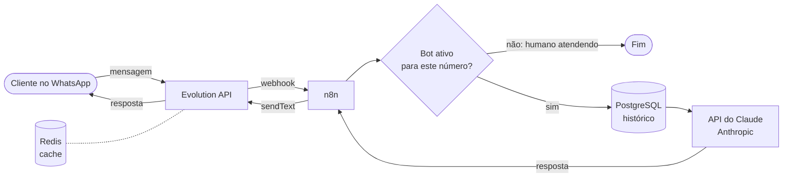

# Bia: atendente com IA para WhatsApp

A Bia é uma agente de IA que atende clientes no WhatsApp 24 horas por dia. Ela responde dúvidas sobre produtos, lembra do histórico da conversa e passa o atendimento para um humano quando é preciso.

Desenvolvi a Bia do zero para uma indústria de resinas de Porto Alegre, que perdia vendas porque recebia muitas mensagens fora do horário comercial. Este repositório traz a infraestrutura e o fluxo de automação. Os dados, os prompts internos e o catálogo da empresa ficaram de fora.

## Como funciona



1. O cliente manda uma mensagem e a **Evolution API** recebe pelo WhatsApp.
2. A Evolution dispara um **webhook** para o **n8n**.
3. O n8n confere se o bot está ativo para aquele número. Quando um atendente humano assume a conversa, a Bia para de responder.
4. O n8n busca as últimas mensagens da conversa no **PostgreSQL**.
5. A **API do Claude** recebe o histórico e a base de conhecimento dos produtos, entende a intenção do cliente e monta a resposta.
6. A resposta volta pela Evolution API para o WhatsApp do cliente.

## Stack

| Peça | Função |
| --- | --- |
| Docker Compose | Sobe os quatro serviços com um comando |
| Evolution API v2 | Conexão com o WhatsApp: recebe e envia mensagens |
| n8n | Orquestra o fluxo: webhook, regras, chamadas de API |
| PostgreSQL 16 | Histórico das conversas e dados do n8n e da Evolution |
| Redis 7 | Cache da Evolution API |
| API do Claude (Anthropic) | Entende a mensagem e gera a resposta |

## Como rodar

Pré-requisitos: Docker e Docker Compose instalados, e uma chave da API da Anthropic.

```bash
git clone https://github.com/Dudu02170/bia-atendente-whatsapp.git
cd bia-atendente-whatsapp
cp .env.example .env      # preencha as senhas e chaves
docker compose up -d
```

Depois de subir:

1. **n8n:** abra http://localhost:5678, importe o fluxo da pasta `workflows/` e cadastre suas credenciais.
2. **Evolution API:** crie uma instância e leia o QR Code com o WhatsApp.
3. **Webhook:** aponte o webhook da instância para a URL do webhook no n8n.
4. Mande uma mensagem para o número conectado e veja a Bia responder.

Para expor o n8n na internet durante os testes, usei o Cloudflare Tunnel:

```bash
cloudflared tunnel --url http://localhost:5678
```

## O que aprendi

- **O difícil não foi a IA, foi integrar as peças.** Gastei mais tempo com formato de payload, versão da Evolution API e rede entre containers do que escrevendo prompt.
- **Dentro do Docker, `localhost` não é o seu computador.** Os serviços se enxergam pelo nome (`http://evolution:8080`), não por `localhost`.
- **Versão importa.** A Evolution API v2 exige banco de dados configurado, e a troca de versão mudou o formato de algumas chamadas.
- **Um humano precisa conseguir assumir.** Pausar o bot por número foi essencial para o time comercial entrar na conversa sem a IA atrapalhar.

## Segurança

- O arquivo `.env` e a pasta `data/` estão no `.gitignore`. Nenhuma senha, chave ou conversa real está neste repositório.
- Use senhas fortes e chaves aleatórias no seu `.env`.

## Autor

**Eduardo Consul** · [LinkedIn](https://www.linkedin.com/in/eduardo-consul-32ab59260/) · [GitHub](https://github.com/Dudu02170)
